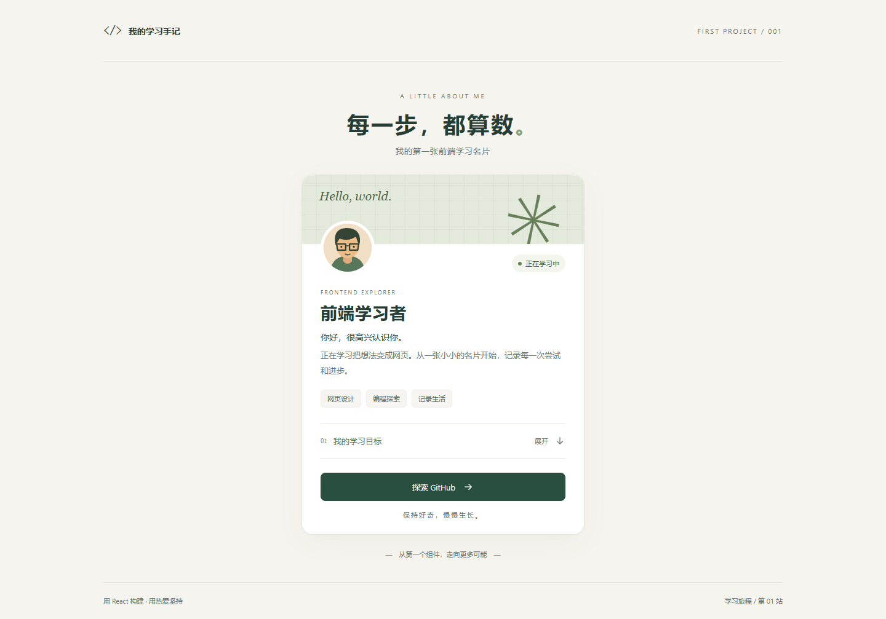

# 我的前端学习名片

第一个 React 小项目：用一张个人介绍卡片练习组件、数据与交互。使用 React、Vite 和普通 CSS，无需后端。

## 页面功能

- 显示本地插画头像、姓名、自我介绍和三个兴趣标签。
- 点击「我的学习目标」展开或收起三个目标，支持键盘操作。
- GitHub 链接在新标签页打开。
- 手机、平板和桌面屏幕自适应。

## 页面预览



[查看手机页面](./docs/mobile.png) · [查看展开学习目标的页面](./docs/desktop-expanded.png)

## 本地运行

先安装 Node.js（本项目在 Node.js 26 环境验证）。在终端进入本文件夹：

```powershell
npm install
npm run dev
```

打开终端显示的本地地址，通常是 http://127.0.0.1:5173 。
按 `Ctrl+C` 停止服务。在 PowerShell 中如果 `npm` 被执行策略阻止，使用 `npm.cmd` 替代。

```powershell
npm run build
npm run preview
```

`build` 生成 `dist` 文件夹；`preview` 用于检查构建后的页面。

## 改成你自己的名片

打开 `src/App.jsx`，找到顶部的 `profile` 对象：

```js
const profile = {
  name: '前端学习者',
  // ...
  githubUrl: '',
};
```

修改姓名、问候语、介绍、兴趣和学习目标。在 `githubUrl` 中填写完整个人主页地址，例如 `https://github.com/你的用户名`。未填写时，按钮显示「探索 GitHub」，链接到官网。

头像位于 `public/avatar.svg`。如果使用自己的照片，把图片放进 `public`，再修改 `App.jsx` 中头像的 `src`、`alt`。样式集中在 `src/styles.css`。

## 代码阅读顺序

1. `index.html`：页面入口和 React 挂载位置。
2. `src/main.jsx`：将 App 组件渲染到页面。
3. `src/App.jsx`：个人数据、组件与按钮交互。
4. `src/styles.css`：布局、颜色和手机适配。

## 这次学到了什么

- **JSX**：在 JavaScript 中描述页面，用 `{}` 显示数据。
- **组件和 props**：`InterestTags` 接收兴趣数组并展示标签。
- **列表渲染**：使用 `map()` 展示兴趣和目标，为列表项设置 `key`。
- **状态**：`useState(false)` 保存学习目标是否展开。
- **事件处理**：点击按钮调用 `setIsExpanded`，React 更新界面。
- **条件渲染**：根据 GitHub 地址是否填写，显示不同按钮文案与链接。
- **响应式 CSS**：使用最大宽度与媒体查询适应手机屏幕。

## 自己再做三个小改动

1. 将姓名和三个兴趣改为你自己的。
2. 添加第四个学习目标，观察列表是否自动更新。
3. 修改背景色和按钮颜色，并检查文字是否仍清晰。

## 上传 GitHub

在 GitHub 创建空仓库（例如 `frontend-practice`），通过 GitHub Desktop 添加上级「前端开发」目录为本地仓库，检查改动，提交后发布仓库。

已有 `.gitignore` 会排除 `node_modules`、`dist` 和环境变量文件。`package-lock.json` 应上传，方便复现依赖版本。不要公开个人隐私或密钥。

提交信息示例：`完成个人介绍卡片和学习目标交互`。
仓库地址：[156524618a-dotcom/frontend-practice](https://github.com/156524618a-dotcom/frontend-practice)。

## 参考文档

- [React 快速入门](https://zh-hans.react.dev/learn)
- [Ant Design 组件总览](https://ant.design/components/overview-cn/)
- [ProComponents](https://pro-components.antdigital.dev/components)

本练习先使用 React 和原生 HTML/CSS；后续练习再学习 Ant Design 和 ProComponents。

## 已完成的验证

- `npm run build` 生产构建成功。
- Edge 浏览器检查：按钮点击与 Enter 键展开/收起正常。
- 320、375、768、1024、1440 像素宽度均无横向溢出（包括展开状态）。
- 头像正常加载，GitHub 链接地址和新标签页属性正确。
- 浏览器无页面异常和控制台错误。
