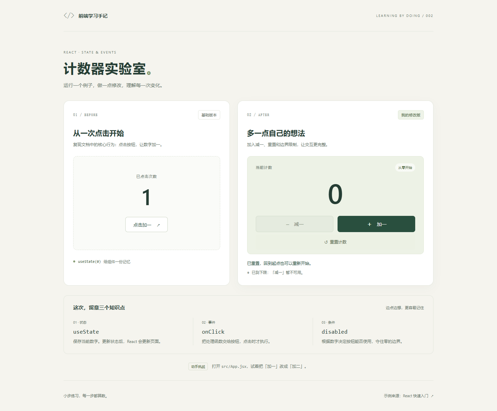

# 02 · 计数器实验室

从 React 官方计数示例出发，练习「运行示例 → 修改代码 → 对比效果」。使用 React + Vite + 普通 CSS，无需后端和额外组件库。

## 示例来源与我的修改

来源：[React 快速入门 · 更新界面](https://zh-hans.react.dev/learn#updating-the-screen)。本项目根据文档示例改写，加入自定义样式，不是官方页面的完整复制。

| 基础版本 | 修改版本 |
| --- | --- |
| 初始显示 0 | 初始显示 0 |
| 点击按钮加一 | 加一、减一、重置 |
| 演示最基本的状态更新 | 在零时禁用减一，并在更新函数中限制下限 |
| 独立的组件状态 | 独立状态，增加操作反馈和边界说明 |

## 本地运行

在本文件夹中打开终端：

```powershell
npm.cmd install
npm.cmd run dev
```

打开终端显示的地址，默认 http://127.0.0.1:5174/ 。若端口被占用，Vite 会选择其他端口，以终端输出为准。按 Ctrl+C 停止服务。

```powershell
npm.cmd run build
npm.cmd run preview
```

生产文件输出到 `dist`；构建预览默认使用 4174 端口。

## 阅读代码

1. `src/main.jsx` 把 App 渲染到 HTML 页面。
2. `src/App.jsx` 中的 `BasicCounter` 只演示点击加一。
3. `ImprovedCounter` 演示三个事件处理函数。
4. `src/styles.css` 控制卡片、数字、按钮与手机布局。

### 状态如何更新

```jsx
const [count, setCount] = useState(0);
```

`count` 保存当前数字；`setCount` 更新状态并触发 React 更新界面。两个计数器各有自己的 state，互不影响。

```jsx
setCount((previous) => previous + 1);
```

根据之前的值计算新值。直接修改普通变量，不会产生相同的 React 状态更新效果。

### 按钮如何响应点击

```jsx
<button onClick={handleIncrement}>加一</button>
```

这里传递函数，不写 `handleIncrement()`，否则会在渲染时直接调用。

### 如何限制下限

```jsx
const isZero = count === 0;
// 按钮上使用 disabled={isZero}
setCount((previous) => Math.max(0, previous - 1));
```

零时禁用减一，更新逻辑也不允许负数。`isZero` 从 count 计算得到，无需另外保存一份状态。

## 你来修改

每次只改一项，先猜效果，再运行验证：

1. 把初始值从 0 改为 10，刷新观察。注意目前重置仍然返回 0；若希望重置为初始值，可以提取 `INITIAL_COUNT` 常量。
2. 把修改版的 `previous + 1` 改为 `previous + 2`，并同步修改按钮文字、提示文案。
3. 给计数增加上限 10，思考如何同时限制更新函数和按钮状态。
4. 修改 `styles.css` 中的 `--green`，观察按钮和文字颜色。

## 验收清单

- 初始两个数字都是 0，修改版减一不可用。
- 加一三次得到 3，减一一次得到 2。
- 重置回到 0，并显示重置提示。
- 操作其中一版，不改变另一版的数字。
- 键盘 Tab 可定位可用按钮，Enter 可触发操作。
- 手机屏幕无横向滚动条。

## 页面截图



[手机预览](./docs/mobile.png)

## 本次验证结果

- 生产构建通过。
- Edge 浏览器中验证了加一、减一、零值禁用、重置、两个组件状态独立，以及 Enter 键操作。
- 连续加一 15 次再减一 15 次，正确回到零。
- 在 320、375、768、1024、1440 像素宽度下无横向溢出。
- 浏览器没有页面异常或控制台错误。
