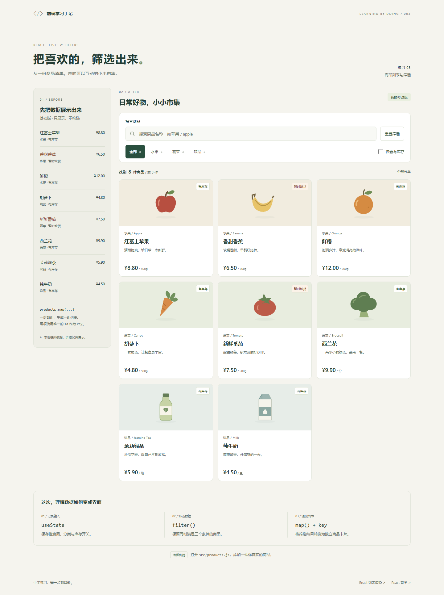

# 03 · 商品列表与筛选

以 React 官方的列表渲染和可搜索商品表为参考，完成「基础清单 → 交互式商品卡片」练习。使用 React + Vite + 普通 CSS，无需后端。

## 示例来源

- [React 快速入门 · 渲染列表](https://zh-hans.react.dev/learn#rendering-lists)
- [React 哲学 · 可搜索的产品数据表](https://zh-hans.react.dev/learn/thinking-in-react)

本项目参考文档中的组件、状态和筛选思路重新编写，商品数据、布局和插画均为本练习自定义；不是官方页面的完整复制。

## 功能与修改

| 基础版本 | 我的修改版 |
| --- | --- |
| 展示 8 件商品的名称、分类、库存和价格 | 商品卡片加入插画、说明和计价单位 |
| 使用 map 渲染固定清单 | 按关键词、分类、库存实时筛选 |
| 缺货商品用文字和颜色标识 | 支持多个筛选条件同时生效 |
| 始终保留全部商品 | 显示结果数量、空结果提示，并支持重置 |

支持中文名称和英文名称搜索，忽略英文大小写和搜索词首尾空格。分类按钮旁的数字表示原始数据中该分类的总数，结果区的数字表示筛选后数量。页面使用本地模拟数据，价格仅供演示，不提供购买功能。刷新后筛选条件回到默认状态。

## 本地运行

在本文件夹打开终端：

```powershell
npm.cmd install
npm.cmd run dev
```

默认打开 http://127.0.0.1:5175/ ，实际地址以终端输出为准。按 Ctrl+C 停止服务。

```powershell
npm.cmd run build
npm.cmd run preview
```

生产文件在 `dist`，构建预览默认使用 4175 端口。

## 文件与阅读顺序

1. `src/products.js`：8 件商品的模拟数据、分类和筛选函数。
2. `src/App.jsx`：三个状态、基础清单、筛选栏和商品卡片。
3. `src/ProductArt.jsx`：本地 SVG 装饰插画。
4. `src/styles.css`：桌面与手机布局。
5. `src/main.jsx`：将 App 渲染到页面。

## 数据如何变成界面

**用户输入 → 更新 state → filter 筛选数组 → map 渲染卡片。**

```jsx
const [query, setQuery] = useState('');
const [category, setCategory] = useState('全部');
const [onlyInStock, setOnlyInStock] = useState(false);

const visibleProducts = filterProducts(PRODUCTS, query, category, onlyInStock);
```

只保存用户改变的三个条件；结果数组可以计算出来，不需要额外用 state 保存，也不需要 useEffect 去同步。

### 受控输入

```jsx
<input value={query} onChange={(event) => setQuery(event.target.value)} />
```

`value` 来自 React 状态，`onChange` 把输入写回状态。复选框对应使用 `checked` 和 `event.target.checked`。

### filter 与 map 的区别

- `filter()` 决定保留哪些数据，不修改原始数组。
- `map()` 将每件商品转换成一个组件。
- `key={product.id}` 帮助 React 识别每件商品；id 必须唯一。

筛选函数中，名称、分类、库存三个判断用 `&&` 连接，因此条件是「同时满足」。左侧基础清单始终使用原始 `PRODUCTS`，不会跟随右侧筛选变化。

### 空结果与可访问性

用结果数组的长度决定显示商品网格还是空结果提示。结果数量使用 `role="status"`，分类按钮使用 `aria-pressed`，搜索框带明确标签，所有交互可以使用键盘操作。

## 你来修改

1. 在 `products.js` 增加一件商品，使用新的唯一 id，并观察总数和分类数量。插画目前为内置商品绘制；新商品可以自行补充对应图案。
2. 把香蕉的 `stocked` 从 `false` 改成 `true`，观察库存筛选的结果。
3. 将搜索范围扩展到商品说明 `note`，比较修改前后搜索「早餐」的结果。
4. 增加「价格不超过 10 元」筛选条件，分别修改状态、筛选函数和界面。

## 手动验收

- 初始右侧显示 8 件商品，左侧清单始终显示 8 件。
- 搜索「苹果」只显示红富士苹果，搜索 ` APPLE ` 也能找到。
- 水果分类有 3 件，叠加库存条件后剩 2 件。
- 只看有库存时，全部分类剩 6 件。
- 搜索不存在的商品或选择互相冲突的条件，显示空结果提示。
- 空结果中的按钮恢复默认条件和 8 件商品。
- 清空搜索只清除关键词，分类和库存保持当前选择；重置筛选清除全部条件。

## 页面截图



[手机预览](./docs/mobile.png) · [组合筛选](./docs/filtered.png) · [空结果](./docs/empty.png)

## 本次验证结果

- `npm.cmd run build` 生产构建成功。
- Edge 浏览器中验证了中文与英文搜索、大小写和首尾空格、全部分类、库存开关、条件组合、空结果、关键词清空与全部重置。
- 验证基础清单不受筛选影响，Enter 键可以触发重置按钮。
- 在 320、375、768、1024、1440 像素宽度下检查普通与空结果状态，均无横向溢出。
- 浏览器无页面异常和控制台错误。
