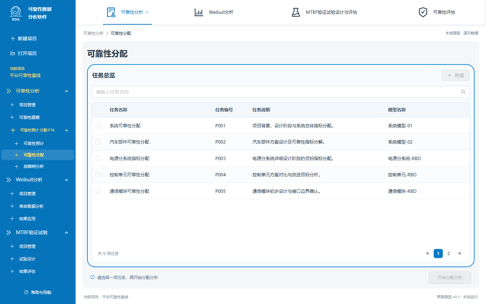

# 可靠性数据分析软件 · 任务总览与可靠性分配

基于 React、TypeScript、Vite 和 **Ant Design 6** 的本地前端原型。源码全部在本目录，页面运行时不使用远程 API、在线图片、字体或托管服务。

## 本阶段完成范围

- 蓝色项目侧栏、RDA 文字标识、白色四模块顶栏、分组导航、黄色当前项目/选中项。
- 可靠性分配页面：任务总览、任务名称搜索、单选、分页、任务数量、行高亮和开始按钮状态。
- 搜索忽略大小写和首尾空格；每次改变搜索重置到第一页，并清除旧任务选择。
- 新建分配任务：填写名称、编号、说明，搜索并单选示例模型，缩放或拖动查看框图。创建后列表回到第一页并选中新任务，同一项目内任务编号不能重复。
- 分配分析：点击“开始分配分析”查看任务信息和等分配界面。可以修改目标可靠度、任务时间和单位，勾选参与组件，查看组件目标、提升状态与系统结果。参数修改后清除旧结果，返回列表可保留搜索、页码和选择。
- 顶栏下拉菜单和侧栏菜单支持切换，模块地址使用 hash；浏览器前进/后退和刷新可恢复模块。
- 打开不同项目时，任务列表隔离；新建项目有必填与编号重复校验，新项目没有分配任务。
- 新建项目和分配任务保存在本机浏览器 localStorage，每个项目独立显示自己的任务。刷新后默认打开第一个项目，当前搜索、页码、选择、分析输入及结果均为当次操作状态。
- 本地存储损坏时恢复默认项目；存储不可写时提示本次数据不会保留。
- 中文帮助弹窗、无匹配结果、无任务项目和后续模块预留页。

## 与附件的对应关系

参照《可靠性分配模块界面-2026.10.12.pptx》第 1～3 页的结构与蓝白配色：

1. 左侧固定蓝色导航，对应新建/打开项目、当前项目和四个功能组。
2. 右侧白色顶栏，对应可靠性分析、Weibull 分析、MTBF 验证试验设计与评估、可靠性评估。
3. 浅灰工作区内显示“可靠性分配”。
4. 蓝色圆角边框内显示任务总览、搜索和表格；分页位于表格底部。
5. “开始分配分析”放在工作区右下方。
6. “新建任务”顶部为任务信息，下方左侧为模型列表、右侧为框图预览。
7. “分配分析”顶部是参数与计算按钮，中间是组件表，底部汇总当前和分配后的系统可靠度。

原始 PPT 不作为背景截图使用。页面的导航、搜索、表格、分页和选择均由真实组件实现；图标用本地打包的 Ant Design Icons，RDA 标记为本地 SVG 重绘。

示例模型可在各项目中使用。等分配演示基于三个串联模型，设定固定失效率，按 1000 小时基准与输入时间换算各组件可靠度。排除未参与组件的影响后，为参与组件分配相同目标。现有可靠度更高时保留原值。循环和公里显示为设计稿中预留的单位，示例模型使用时间单位。

## 尚未实现的模块

- 权重分配法和成本最优分配法在方法下拉中预留。没有匹配示例模型的历史任务可查看任务信息。
- 建模、预计、FTA、Weibull、MTBF、指标评估、报告等显示明确的工作区预留说明。
- 侧栏各“项目管理”入口当前共用项目总览，不代表各模块拥有了完整独立的业务项目管理。
- 没有后端、用户登录、真实模型读取和计算接口。

## 启动

已在用户电脑的 Node.js 26 环境安装并运行。本地实际依赖版本由 `package-lock.json` 锁定，可用 `npm.cmd ls --depth=0` 查看。

```powershell
cd "C:\Users\lenovo\Documents\ChatGPT\前端开发\reliability-workbench"
npm.cmd install
npm.cmd run dev
```

已安装依赖时不必重复执行 install。也可以双击 `start-local.cmd`。默认地址为 **http://127.0.0.1:5180/**，以终端输出为准；Ctrl+C 停止。

只需依赖安装时访问 npm；之后开发运行、构建与页面交互都在本地完成。原型没有自动上传功能。

```powershell
npm.cmd run typecheck
npm.cmd run build
npm.cmd run preview
```

构建产物在 `dist/`，预览默认端口 4180。`node_modules/` 是依赖，不是业务源码；不需要逐文件修改，也不应上传 Git。

## 所有代码在哪里

```text
reliability-workbench/
  index.html
  package.json / package-lock.json
  tsconfig.json
  vite.config.ts
  start-local.cmd
  src/
    main.tsx                         # 入口、中文语言包、antd 主题
    App.tsx                          # 项目状态、工作区切换、帮助
    styles.css                       # 与附件对应的颜色、结构和桌面布局
    components/
      WorkbenchHeader.tsx            # 四模块顶栏
      WorkbenchSidebar.tsx           # 蓝色导航、项目入口和当前项目
    domain/types.ts                  # 项目/任务类型与路由标题
    data/fixtures.ts                 # 可直接修改的模拟数据
    hooks/useRoute.ts                # hash 模块切换及前进/后退
    services/                        # 本机项目、任务存储与数据检查
    data/demoModels.ts               # 串联演示模型和组件基准值
    domain/equalAllocation.ts        # 等分配示例计算
    features/
      allocation/TaskOverview.tsx    # 搜索、分页、单选与任务总览
      allocation/TaskPreparation.tsx # 任务信息与分析工作区入口
      allocation/CreateTaskDialog.tsx # 新建任务与模型选择
      allocation/ModelPreview.tsx     # 框图预览、缩放和拖动
      allocation/EqualAllocationWorkspace.tsx # 分配参数、组件表与结果
      projects/ProjectDialogs.tsx    # 打开/新建项目弹窗
  scripts/test_ui.py                  # 可重复运行的浏览器交互检查
  docs/screenshots/                   # 实际运行截图
```

建议先阅读 `src/data/fixtures.ts` 和 `TaskOverview.tsx`，再阅读 `App.tsx` 的项目切换逻辑，最后调整 `src/styles.css`。表格显示值和选择逻辑都在源码里，不依赖封装的远程服务。

## 验收演示

1. 打开默认项目，确认未选任务时“开始分配分析”不可用。
2. 点击某行/单选框，查看高亮和所选任务名称；点击开始核对任务名称、编号、模型。
3. 返回列表，切到第 2 页；搜索“电源”，观察回到第 1 页且旧选择清空。
4. 输入不存在的名称，观察空结果；清空搜索恢复。
5. 打开“机载电源可靠性分析”，确认只有该项目的 2 条任务。
6. 打开“控制器方案评审”，查看无任务状态。
7. 新建项目，先验证必填与重复编号，再创建并刷新检查保存。
8. 创建一个分配任务，搜索并选择模型，缩放预览后保存。进入分析，点击“优化计算”，尝试修改任务时间或勾选状态再计算。
9. 切换顶栏或侧栏其他模块，观察预留说明；用浏览器后退返回。

## 桌面布局

目标是与附件一致的桌面工程软件，优先检查 1366×768、1440×900、1920×1080。侧栏固定，功能列表在低高度下可独立滚动；表格关键操作保持可见。

小于 1000 像素宽度时保留桌面最小布局，允许横向滚动；本阶段不把密集工程工作区改成手机页面。

## 测试

本机已有 Python Playwright 与 Edge。先启动开发服务器，然后在项目目录运行：

```powershell
python scripts/test_ui.py
```

脚本使用独立的临时浏览器上下文，检查列表与导航、新建任务、模型预览、数据隔离和持久化、分配校验与示例计算、结果过期状态、桌面布局与网络请求。

检查生产构建可使用：

```powershell
$env:WORKBENCH_URL = 'http://127.0.0.1:4180/'
python scripts/test_ui.py
Remove-Item Env:WORKBENCH_URL
```

## 页面截图



[1366 屏幕](./docs/screenshots/overview-1366.png) · [1920 屏幕](./docs/screenshots/overview-1920.png) · [搜索和选择](./docs/screenshots/filtered.png) · [任务信息](./docs/screenshots/task-info.png) · [空项目](./docs/screenshots/empty-project.png)

[新建任务与模型选择](./docs/screenshots/create-task.png) · [等分配示例结果](./docs/screenshots/equal-allocation.png)
